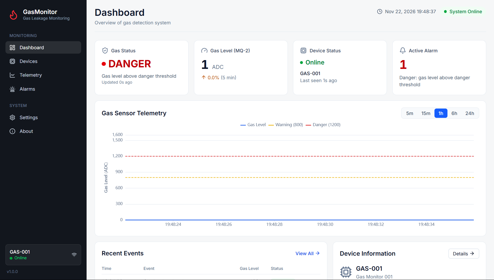

# GasMonitor

An ESP32-based gas leakage detection and monitoring system built around the MQ-2 gas sensor, with a local FastAPI backend and React monitoring dashboard.

<p align="center">


</p>

## Preview

<p align="center">
  
</p>

<p align="center">
  <em>GasMonitor monitoring dashboard — local FastAPI telemetry integration.</em>
</p>

## Project Overview

GasMonitor is a gas leakage detection and monitoring system built around an ESP32 and MQ-2 gas sensor.

The system is designed around two independent operational paths:

1. **Local Safety Path** — The ESP32 evaluates the MQ-2 sensor state and directly controls the local LED and buzzer alarm.

2. **Monitoring Path** — ESP32 telemetry is transmitted through HTTP/JSON to a local FastAPI backend and visualized through a React-based web dashboard.

The local hardware alarm remains independent from the web application. This ensures that the primary alarm mechanism does not depend on network connectivity or dashboard availability.

The current development phase focuses on integrating the ESP32 telemetry flow with a local FastAPI backend and monitoring dashboard.

## Architecture

```text
┌───────────────┐
│   MQ-2 Sensor │
└───────┬───────┘
        │
        ▼
┌────────────────────┐
│       ESP32        │
│                    │
│ Local Alarm Logic  │
│    LED + Buzzer    │
└─────────┬──────────┘
          │
          │ HTTP / JSON
          ▼
┌────────────────────┐
│   FastAPI Backend  │
│                    │
│   In-Memory State  │
└─────────┬──────────┘
          │
          │ REST / JSON
          ▼
┌────────────────────┐
│   React Dashboard  │
│                    │
│ Telemetry Monitor  │
└────────────────────┘
```

### Communication Flow

```text
ESP32
  │
  │ POST /api/v1/telemetry
  ▼
FastAPI
  │
  │ REST API
  ▼
React Dashboard
```

The frontend polls the REST API approximately every 2 seconds.

## Project Status

**Current phase:** Local frontend/backend integration

| Component | Status |
|---|---|
| React frontend | Implemented |
| FastAPI backend | Implemented |
| REST telemetry integration | Implemented |
| Device state | In-memory |
| Telemetry state | In-memory |
| Frontend polling | Implemented |
| ESP32 local alarm | Implemented |
| ESP32 telemetry integration | Implemented locally |
| Persistent telemetry storage | Future |
| CSV backup | Future |
| Database | Not implemented |
| Authentication | Not implemented |

The backend currently uses in-memory storage. Device and telemetry data are therefore lost when the backend process stops.

The firmware source is maintained locally for hardware development and is intentionally excluded from Git tracking.

## Product Goal

GasMonitor provides a clear monitoring interface for:

- Current gas sensor state
- MQ-2 raw sensor value
- Gas telemetry trends
- Device connectivity
- Alarm events
- Device information
- Historical telemetry
- Detection configuration

The dashboard is a monitoring interface, not the primary safety mechanism.

Local hardware alarms remain independent of the web application.

## Technology Stack

### Frontend

- React
- TypeScript
- Vite
- React Router
- TanStack Query
- Tailwind CSS
- Lucide React
- Apache ECharts

### Backend

- Python
- FastAPI
- Pydantic
- In-memory device and telemetry state

### Hardware

- ESP32
- MQ-2 gas sensor
- OLED display
- Buzzer
- Red LED

### Communication

- HTTP/JSON
- REST API
- Local LAN communication
- Frontend polling

## Repository Structure

```text
gas-monitor/
├── README.md
├── docs/
│   ├── screenshots/
│   │   └── dashboard-preview.png
│   ├── PRD.md
│   ├── DESIGN-SYSTEM.md
│   ├── ARCHITECTURE.md
│   ├── DATA-MODEL.md
│   ├── FRONTEND-ARCHITECTURE.md
│   ├── API-CONTRACT.md
│   ├── PROJECT-LOCK.md
│   ├── DEVELOPMENT-GUIDE.md
│   └── ROADMAP.md
│
├── frontend/
├── backend/
└── docker-compose.yml
```

The ESP32 firmware is maintained locally and excluded from Git tracking to prevent local hardware configuration and credentials from being committed to the repository.

## Current Frontend Scope

The frontend currently provides:

- Dashboard
- Device overview
- Device detail
- Telemetry
- Alarm history
- Settings
- About

Device and telemetry views are connected to the FastAPI backend.

Alarm history currently uses temporary mock data until a dedicated alarm endpoint is implemented.

Mock data should remain isolated from presentation components and should not be embedded directly inside UI components.

## API

The current backend exposes the following endpoints:

```text
GET  /api/v1/health
GET  /api/v1/devices
GET  /api/v1/devices/{device_id}
GET  /api/v1/devices/{device_id}/telemetry
POST /api/v1/telemetry
```

Telemetry is exchanged using JSON.

A typical telemetry payload follows this structure:

```json
{
  "device_id": "GAS-001",
  "sensor": "MQ-2",
  "value": 442,
  "gas_status": 0,
  "timestamp": "2026-11-22T19:00:00+07:00"
}
```

`gas_status` represents the detected gas state:

```text
0 = Normal
1 = Gas Detected
```

The `value` field currently represents the raw sensor value and must not be interpreted as calibrated gas concentration.

## Local Development

### Frontend

```bash
cd frontend
npm run dev
```

Default development URL:

```text
http://localhost:5173
```

### Backend

```bash
cd backend
uvicorn app.main:app --host 0.0.0.0 --port 8000
```

Backend URL:

```text
http://localhost:8000
```

API base:

```text
http://localhost:8000/api/v1
```

### Frontend API Configuration

Copy:

```text
frontend/.env.example
```

to:

```text
frontend/.env.local
```

Configure:

```env
VITE_API_BASE_URL=http://localhost:8000
```

For a backend running on another machine in the same LAN:

```env
VITE_API_BASE_URL=http://192.168.1.10:8000
```

Use the actual LAN address of the backend machine.

Do not place Wi-Fi passwords, API keys, authentication tokens, or other secrets inside the repository.

## Important Sensor Note

The MQ-2 is currently represented as a raw sensor measurement.

Raw MQ-2 readings must **not** be presented as calibrated gas concentration in parts per million (ppm).

Converting MQ-2 measurements into an estimated gas concentration requires a defined calibration methodology, reference concentration, sensor characteristics, and appropriate measurement conditions.

Therefore, the current dashboard intentionally treats the MQ-2 value as a raw sensor value rather than a calibrated ppm measurement.

## Design Philosophy

GasMonitor follows a modern industrial monitoring visual language.

The interface should be:

- Precise
- Calm
- Technical
- Readable
- Restrained
- Professional

The interface should avoid:

- Excessive gradients
- Neon effects
- Glassmorphism
- Excessive blur
- Decorative 3D elements
- Animated backgrounds
- Excessive rounded cards
- Unnecessary visual effects
- Oversized typography
- Decorative elements without functional meaning

Visual hierarchy and operational clarity take priority over visual novelty.

## Development Principle

GasMonitor follows a separation-of-concerns architecture.

Frontend UI must not contain backend implementation details.

Mock data must not be embedded directly inside visual components.

Backend integration should occur through a dedicated data-access layer.

The hardware safety path should remain independent from the monitoring dashboard.

Future persistent storage should be introduced without coupling storage implementation directly to frontend presentation logic.

## Future Development

Planned development includes:

- Persistent telemetry storage
- CSV telemetry backup
- Extended telemetry history
- Dedicated alarm API
- Sensor calibration workflow
- Improved device management
- Additional instrumentation analysis
- Production deployment configuration

The project scope may evolve according to the technical requirements defined in the project documentation.

## Documentation

Read the following documents before making architectural changes:

- `docs/PROJECT-LOCK.md`
- `docs/PRD.md`
- `docs/ARCHITECTURE.md`
- `docs/DESIGN-SYSTEM.md`
- `docs/FRONTEND-ARCHITECTURE.md`
- `docs/API-CONTRACT.md`

`PROJECT-LOCK.md` has the highest authority over project scope and technical decisions.

## Developed by

**Galuh Kurnia Pratama**

Physics Student · Instrumentation · Software Engineering Entusiast

Building practical systems through the integration of **physics, electronics, software, and engineering**.

---

© 2026 Galuh Kurnia Pratama. All rights reserved.
